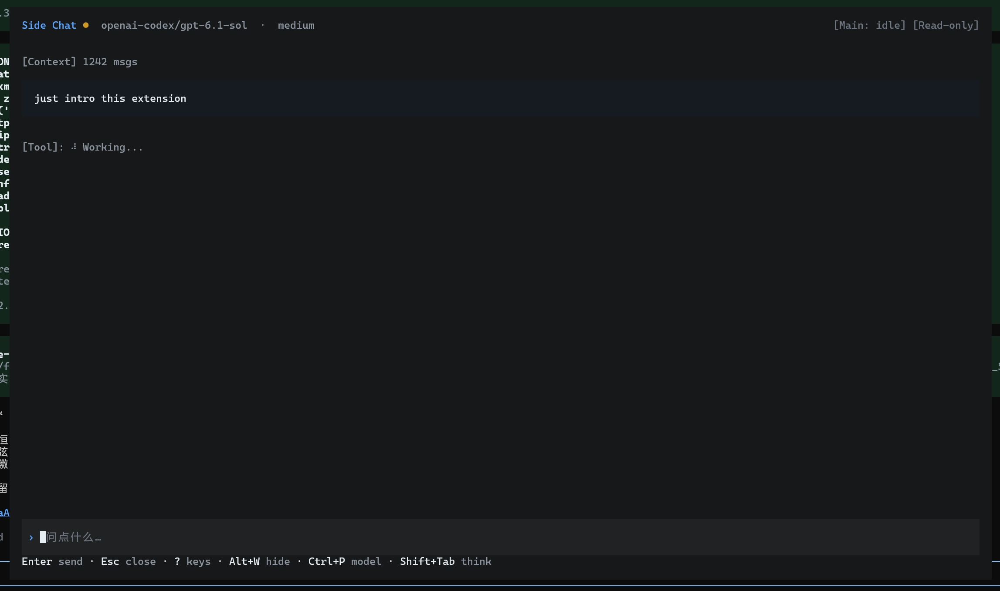

<p>
  
</p>

# @yceachan/pi-better-btw

**English | [简体中文](README.zh-CN.md)**

> [!note]
>
> This package is a maintained fork of [nicobailon/pi-side-chat](https://github.com/nicobailon/pi-side-chat) — original author **Nico Bailon**; extended by **yceachan** and maintained in [ea-pi-extensions](https://github.com/yceachan/ea-pi-extensions). Thanks to **[De0ta](https://github.com/De0ta)** for the model controls, layouts and themed UI contributed in [PR #5](https://github.com/yceachan/ea-pi-extensions/pull/5).

## TL;DR

**Fork the current conversation into a side chat (`btw`) while the main agent keeps working.**

[](https://www.npmjs.com/package/@yceachan/pi-better-btw)
[](LICENSE)

Requires Pi 1.4 or later.

```bash
pi install npm:@yceachan/pi-better-btw
# in pi tui
> /btw  || or Alt+W
```

You're in the middle of a longer task and want to ask something small without derailing the main thread — check an API detail, sanity-check an approach, search something, or peek at what the main agent is doing. Open the btw TUI overlay, ask, then hide it. The main thread never gets interrupted.



## Feat

> [!note]
>
> **That's Why It's Called Better-Btw**
>
> The author tried [nicobailon/pi-side-chat](https://github.com/nicobailon/pi-side-chat) and [dbachelder/pi-btw](https://github.com/dbachelder/pi-btw) — both are simple forks from the main lane: when the agent is on turn, both tend to try to advance the main line. See [feat request: btw aside-session self-cognition — the side chat must not continue the main session's work · Issue #5 · nicobailon/pi-side-chat](https://github.com/nicobailon/pi-side-chat/issues/5).
>
> Hence the following features were carefully developed:

- `Aside-Agent self-Cognition`: injects the main-lane context so you can ask a btw question about the project's main line. Careful context engineering strengthens the side agent's cognition and keeps the full main-lane context's tool-call traces from polluting it or competing with the main lane to advance the project. The shared main-lane prefix is preserved for good cache hits.

- `Prompt pack`: every injected prompt is documented, with three-level overrides — `bundle` / `$PI_HOME` / `$CWD`.

- `TUI scroll, select, copy`: subscribes to mouse/hotkey events in the TUI overlay for scrolling, text selection, and `Ctrl+C` copy.

- `Readonly/Edit Mode`: read-only by default to answer btw questions; if you want the agent to make small edits along the way, `Ctrl+T` switches to edit mode.

  - ToolAllowList: bundle + config.json custom

  | Mode | Tools |
  | ---- | ---- |
  | Read-only | `read`, `grep`, `find`, `ls`; `peek_main`; `config.json.readOnlyExtensionAllowlist` |
  | Edit | `read`, `bash`, `edit`, `write` |

## Usage

Open the side chat with `/btw` (alias `/side`) or `Alt+W` (which also toggles background/display). Ask a question and press `Enter`.

While a response is running, `Esc` stops the current turn and leaves the chat open. Once idle, `Esc` hides the overlay, retaining the session, history, draft and scroll position. Inside a model/thinking picker or help page, `Esc` first returns to the chat. `Alt+W` hides/restores even while generation continues. Only `Alt+N` discards the current side-chat session and starts an empty one; `/btw-close` and `Alt+R` are no longer available.

The default main footer shows `[● side chat]` beside its model: yellow while generating, green when idle, including while hidden. It disappears on close. Custom footers are not replaced; they receive a standard keyed status fallback.

The side chat has its own model and thinking level, initially inherited from the main session but independently remembered for the current Pi process. `Ctrl+P` / `Ctrl+Shift+P` cycle scoped models, `Shift+Tab` cycles supported thinking levels, and `Alt+P` is an alternative backward-model key. These actions follow Pi's configured bindings. `Alt+M` opens searchable model selection; `Alt+T` opens thinking selection. Stop a running turn with `Alt+S` before switching. Main-session settings are never changed.

The borderless panel follows the main theme and terminal colors, subtly separated from the main background. User messages have padded cards with a thin left rail; the rail is decorative and is not copied. AI replies use Pi's native Markdown/code/thinking renderer without a separate message background; thinking and tool details follow the [quiet display switch](#btw-quiet). The inset editor grows from three rows to at most five content rows, keeping its cursor visible. Its `›` marker and “问点什么…” placeholder are presentation only. Common hints fit on one row when space permits; type `?` on an empty draft for the full responsive shortcut page.

| Shortcut | Action |
| -------- | ------ |
| `Alt+W` | Open (when closed) / background (when visible) / restore (when hidden) |
| `Ctrl+T` | Toggle read-only / edit mode |
| `Alt+N` | Discard the session and start an empty conversation |
| `Alt+E` | Export the transcript to `$CWD/.agents/eval/pi-better-btw-<timestamp>.md` |

In Read-only Mode (default), the read-only lane is **enforced**: attempting an out-of-lane tool call is hard-blocked with a prompt injection; a second violation escalates the wording and aborts the turn (a `🚧 lane blocked` status line). Executed-but-failed read-only calls are re-grounded by an `afterToolCall` note. Edit mode (`Ctrl+T`) is unaffected.

**Peek at the main agent** — the `peek_main` tool reads recent activity from the main session.

```text
What is the main agent doing right now?
What changed since I opened this side chat?
```

**Backgrounding** — the default overlay is centered at 90% terminal width and up to 92% height. `Alt+W` hides it while the agent keeps streaming, handing the keyboard back to the main session; `Alt+W` restores it.

**Live layouts** — `Ctrl+Alt+←` fills the terminal, `Ctrl+Alt+↑` selects the original smaller top-center window (85% width), `Ctrl+Alt+↓` restores the larger centered floating window, and `Ctrl+Alt+→` uses the right half at full height. These keys also work inside pickers/help. Switching preserves the agent, history and draft; only the active text selection is cleared because wrapping changes. Layouts adapt to terminal resizing and reserve the actual multiline editor height.

**Message navigation** — `Ctrl+↑`/`Ctrl+↓` jump between user prompts and final AI responses, skipping tools and following Pi's `tui.altScreen.previousPrompt`/`nextPrompt` remaps. Streaming AI text is included; the draft and running agent are preserved.

**Scroll the history** — `PgUp`/`PgDn` scroll by a page, `Shift+↑`/`Shift+↓` by a few lines, and the mouse wheel scrolls when the pointer is over the chat. When scrolled away from the latest message, a `[↑N]` indicator appears in the header. While streaming, the viewport follows the bottom until you scroll away, then freezes content-anchored (new lines grow the scroll offset instead of sliding the visible content); it resumes following once you're back at the bottom or a new message arrives.

**Mouse select + hotkey copy** — drag to select chat text (inverse-video highlight); double-click selects the whole rendered line. Copying is hotkey-only: `Ctrl+C` / `Ctrl+Shift+C` copies the retained selection through the native clipboard cascade (`wl-copy`/`xclip`, OSC 52 fallback); the selection stays highlighted so repeated presses re-copy. Dragging never touches the clipboard, so mouse interaction stays off the event loop. In Pi fullscreen mode, the overlay uses Pi's normalized mouse dispatch and drag capture; clicking the input area positions its cursor. Backgrounding or closing the chat leaves Pi's main-screen mouse controls intact. In regular mode, extension-owned mouse reporting follows overlay *visibility*, so backgrounding restores terminal-native selection.

**Transcript export** — `Alt+E` dumps the btw history (forked context, framing block, conversation, in-flight stream) to `$CWD/.agents/eval/pi-better-btw-<timestamp>.md` as a markdown diagnostic artifact, useful for debugging feature work.

## Shortcuts

| Key | Action |
| ---- | ---- |
| `Alt+W` | Open (when closed) / background (when visible) / restore (when hidden) |
| `Enter` | Send message |
| `Esc` | Stop the running turn; hide when idle; return from pickers/help |
| `?` | Full shortcut page (empty draft only) |
| `Ctrl+Alt+←` / `↑` / `↓` / `→` | Fullscreen / smaller floating / larger floating / right-half layout |
| `Ctrl+↑` / `Ctrl+↓` | Previous / next message (Pi bindings) |
| `Ctrl+P` / `Ctrl+Shift+P` | Cycle side-chat model forward / backward (Pi bindings) |
| `Alt+P` | Cycle model backward (alternative key) |
| `Shift+Tab` | Cycle supported thinking levels (Pi binding) |
| `Alt+M` / `Alt+T` | Search models / pick thinking level |
| `Alt+S` | Stop the current turn, keeping the chat |
| `Alt+N` | Discard the session and start an empty conversation |
| `Alt+E` | Export the btw chat history to `$CWD/.agents/eval/pi-better-btw-<timestamp>.md` |
| `Ctrl+T` | Toggle read-only / edit mode |
| `PgUp` / `PgDn` | Scroll history by a page |
| `Shift+↑` / `Shift+↓` | Scroll by a few lines |
| Mouse wheel | Scroll when the pointer is over the chat |
| Mouse drag | Select text in the chat area (inverse-video highlight); no copy on release |
| Double-click | Select the whole rendered line |
| `Ctrl+C` / `Ctrl+Shift+C` | Copy the active mouse selection (hotkey-only; the selection is kept until you click elsewhere, so repeated presses re-copy) |

## Command Reference

### `/btw`

Opens the side chat overlay. Alias for `/side`.

### `/side`

Opens the side chat overlay (upstream name kept as a compatibility alias).

### `/btw-quiet`

Toggle side-chat quiet display from either the main editor or the side-chat editor. It is **on by default**: thinking becomes a short `Thinking...` label, and tool calls retain one useful line such as `read src/index.ts` or `bash bun run test`. Successful results add no extra row; failures remain visible. The header displays `[Quiet]`. Toggle off to expand thinking, tool arguments and full text results, including existing history and the current streamed response.

Both entry points share one setting remembered for the current Pi process, including before the first side-chat open and across hide/restore or `Alt+N`. The side-chat command also works during generation and is handled locally. Toggling returns the viewport to the latest content and clears text selection; main-session rendering, model context and exported transcripts remain unchanged.

### `peek_main`

Available to the side agent only.

| Param | Type | Description |
|-------|------|-------------|
| `lines` | integer | Max items to inspect (default: 20, max: 50) |
| `since_fork` | boolean | Only show activity after the side chat was opened |

## Configuration

pi-better-btw reads `config.json` from three locations, layered in increasing precedence — a layer only overrides the keys it actually defines:

| Layer | Location |
|---|---|
| Bundle (defaults) | `config.json` next to the extension — git-tracked, ships with the published package |
| User | `~/.pi/agent/pi-better-btw/config.json` |
| Project | `<project>/.pi/pi-better-btw/config.json` |

Keys:

- `readOnlyExtensionAllowlist` — extension tool names allowed in the read-only lane (the lane always includes the builtin read tools `read`/`grep`/`find`/`ls` and `peek_main`). Lists are **unioned** across layers in bundle → user → project order (deduped, first occurrence wins): a user/project layer adds tools, it never drops the defaults shipped below it.
- `readOnlyExtensionAllowlistExclude` — tool names removed from the final list, e.g. to drop a bundled default.
- `promptPack` — prompt-pack manifest (see below); merges per key with the higher layer winning. Relative paths resolve against the layer's own directory, so a user-level manifest can live next to the user config; absolute paths work too.

Example (user or project layer):

```json
{
  "readOnlyExtensionAllowlist": ["pi-vision-helper", "lens_diagnostics"],
  "readOnlyExtensionAllowlistExclude": ["web_search"]
}
```

### Prompt pack manifest

`promptPack` maps each injected prompt to a markdown file (relative to the layer's directory, or absolute). All keys are optional — an absent or unreadable key falls back to the bundled `prompts/` default (with a UI warning):

| Key | Bundled default | Injected |
|-----|-----------------|----------|
| `promptPack.framing` | `prompts/btw-framing.md` | after the forked context (never rendered as a chat bubble) — frames the cite as reference-only |
| `promptPack.focusAnchor` | `prompts/btw-focus-anchor.md` | every turn — "answer only the latest btw message" |
| `promptPack.laneReminders.base` | `prompts/lane-reminder-base.md` | first read-only-lane violation (`{{tool}}` / `{{count}}`) |
| `promptPack.laneReminders.escalated` | `prompts/lane-reminder-escalated.md` | second violation, before the turn abort |
| `promptPack.laneReminders.failedNote` | `prompts/lane-failed-note.md` | after an executed-but-failed read-only call |
| `promptPack.laneReminders.preamble` | `prompts/lane-preamble.md` | read-only lane preamble |

The bundled `config.json` ships the official pi tool set in the read-only allowlist (`web_search`, `source_check`, `fetch_content`, `get_search_content`); third-party tools (pi-lens, context7, vision, …) are added through the user layer.

## How It Works

The extension clones the current session context, creates a separate agent instance with all extension-registered tools, and renders it in a TUI overlay. Opening commands return as soon as the overlay is mounted, so the main input loop can continue dispatching commands while the chat is visible or hidden. The UI interaction runs independently until session teardown or `Alt+N`. Hiding preserves the agent and draft; `Alt+W` also keeps a running response active. `Alt+N` aborts the old session and opens an empty one with the remembered side-chat model and thinking settings.

The default-footer badge adapts the exported `FooterComponent` renderer without editing installed Pi files or taking over `setFooter`. It restores the renderer on shutdown. A keyed `setStatus` remains available when custom footers are switched at runtime. Model-row placement depends on Pi footer internals, covered by a real-renderer regression test.

Side-chat requests use `modelRegistry.streamSimple` so Pi's model runtime handles authentication, request headers and virtual-model routing.

The btw context keeps the main lane's system prompt in the system slot and injects the fork snapshot verbatim, so the btw request head is a token prefix of the main request (gateway prefix-cache hits). `forkSurgery` (`srcs/fork-surgery.ts`) makes the trailing tool exchange gateway-legal on the snapshot; the prompt pack supplies all injected prompt text; lane enforcement wraps `beforeToolCall`/`afterToolCall` (`srcs/side-chat-overlay.ts`) in the read-only lane only.

Main-agent tool execution events are tracked to maintain a set of written file paths (`srcs/file-activity-tracker.ts`); write-capable tools are wrapped to warn before touching those paths (`srcs/tool-wrapper.ts`).

In Pi fullscreen mode, `SideChatOverlay.handleMouse()` receives component-local events from Pi. It handles wheel scrolling, captures chat selection drags, and forwards input-area clicks to the editor. Clipboard copying stays hotkey-only. Pi owns terminal mouse reporting throughout the overlay lifecycle. In regular mode, a raw SGR listener enables reporting only while the overlay is visible and consumes mouse sequences before they reach the editor.

`peek_main` reads the current session branch on demand and returns a compact summary.

## Development

Structure:

```text
.
├── srcs/                  # TypeScript implementation (pi loads TS directly, no build step)
│   ├── index.ts           # extension entry: commands, shortcut, overlay lifecycle
│   ├── config.ts          # layered config resolution (bundle / user / project)
│   ├── prompt-pack.ts     # prompt-pack manifest loader + template substitution
│   ├── fork-surgery.ts    # shared-prefix fork snapshot surgery (gateway-legal tails)
│   ├── side-chat-overlay.ts  # TUI overlay, agent lifecycle, lane enforcement, mouse routing
│   ├── side-chat-messages.ts # message rendering, wrapping, selection, scrolling
│   ├── side-chat-status.ts   # main-footer indicator and keyed fallback
│   ├── side-chat-dialog.ts   # model/thinking selection cards
│   ├── side-chat-help.ts     # responsive hints and shortcut page
│   ├── side-chat-input.ts    # input card, cursor and mouse-coordinate mapping
│   ├── side-chat-panel.ts    # theme/terminal-derived surfaces
│   ├── side-chat-layout.ts   # live layout presets
│   ├── side-chat-mouse.ts    # minimal SGR mouse parsing
│   ├── side-chat-export.ts   # Alt+E transcript export
│   ├── tool-wrapper.ts       # write-path overlap warnings
│   └── file-activity-tracker.ts
├── prompts/               # bundled prompt-pack defaults (framing, focus anchor, lane reminders)
├── test/                  # bun test suites (config resolution, mouse select)
├── config.json            # bundled defaults (promptPack manifest + read-only allowlist)
├── banner.png
├── preview.jpg
└── README.md
```

Commands:

```bash
bun install         # install dependencies
bun run typecheck   # tsc --noEmit -p tsconfig.json
bun run test        # registered automated tests (serial, see bunfig.toml)
```

The published package ships `srcs/`, `prompts/`, `config.json` and the docs; tests stay out of the tarball. To load the extension in pi during development, point pi's extension loader at `./srcs/index.ts` and `/reload` after edits (no build step — pi loads TypeScript directly).

## Limitations

- One side chat at a time
- Won't open on top of another visible overlay
- Does not merge messages back into the main thread
- Bash overlap detection is heuristic — catches common write patterns, not all
- `peek_main` is on-demand, not live
- Requires Pi 1.4+; fullscreen mouse support uses Pi's component mouse API, with the regular-mode SGR path retained

## License

MIT — see [LICENSE](LICENSE). The license retains both copyright lines: the original upstream author (Nico Bailon) and the fork's modifier (yceachan).
